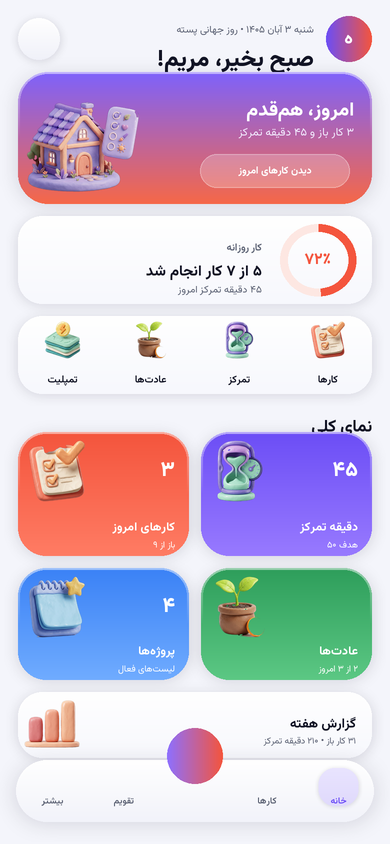
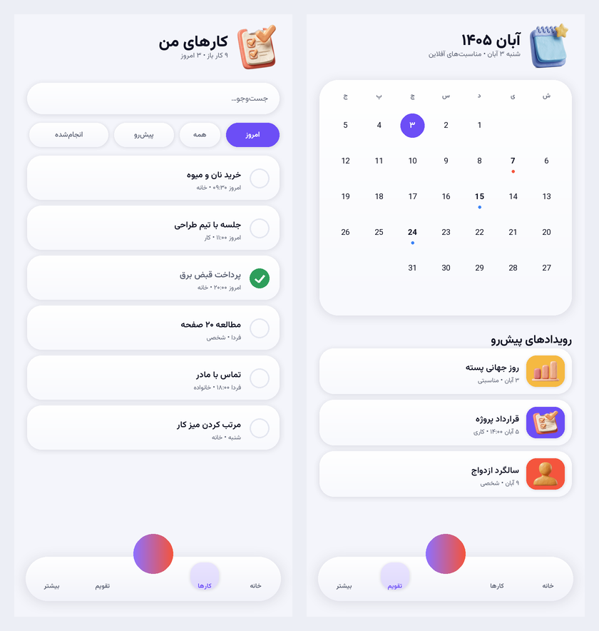

# زبان طراحی سه‌بعدی «خمیری» (Clay / 3D) — نسخهٔ ۰.۶.۰

این سند توضیح می‌دهد تصاویر مرجعی که فرستادی چگونه به یک زبان طراحی قابل‌کد تبدیل شدند، چه چیزی ساخته شد و چه چیزی هنوز نشده.

---

## ۱) از تصویر مرجع به قاعدهٔ طراحی

سه تصویر مرجع سه ایدهٔ مشترک داشتند:

| الگو در مرجع | معادل در هم‌قدم |
|---|---|
| کارت‌های رنگی بزرگ با تصویر سه‌بعدی در گوشه | `ClayTile` — کاشی بنتو با تصویر سفالی، عدد درشت، عنوان و زیرنویس |
| کارت سفید با سایهٔ نرم و گوشهٔ ۲۴–۳۰ | `ClayCard` + بازنویسی `SoftCard` با گرادیان عمودی و خط نور بالای کارت |
| نوار پایین شناور با دکمهٔ مرکزی برجسته | `FloatingNavBar` با گرادیان بنفش→مرجانی و حاشیهٔ نور |
| تصویر سه‌بعدی مخصوص هر بخش | هشت تصویر سفالی مستقل (خانه، کارها، تقویم، تمرکز، عادت، پروفایل، تمپلیت، آمار) |
| تیتر بزرگ + زیرنویس کوچک | `ScreenHeader` با تصویر بخش کنار عنوان |

## ۲) اصول اجرایی

1. **عمق واقعی، نه سایهٔ تصادفی.** هر سطح سه لایه دارد:
   - سایهٔ محیطی پهن (`ambientColor` با آلفای ۰.۵۵) برای «شناور بودن»؛
   - سایهٔ تماس تنگ برای «نشستن روی صفحه»؛
   - گرادیان عمودی روشن→تیره (۴–۱۴٪) که حس حجم می‌دهد؛
   - خط نور ۱dp در لبهٔ بالا با محو شدن به پایین (شبیه نور از بالا).
2. **فشردن = فرورفتن.** هر کارت/کاشی کلیک‌پذیر با `MutableInteractionSource` فشار را می‌فهمد و تا ۹۷.۵٪ کوچک می‌شود و ارتفاعش را از ۱۰dp به ۳dp کم می‌کند — همان حسی که یک کلید فیزیکی می‌دهد.
3. **حرکت آرام و کوچک.** تصویر هر بخش در یک حلقهٔ ۴.۲ ثانیه‌ای تا ۶dp بالا/پایین می‌رود و در ۶.۲ ثانیه ±۲.۲ درجه می‌چرخد. هیچ حرکت تند یا تکراری سریع وجود ندارد.
4. **حالت سکون، حالت نهایی است.** همهٔ انیمیشن‌ها فقط روی لایهٔ `graphicsLayer` اجرا می‌شوند (بدون remeasure) و اگر سیستم «حذف انیمیشن» را فعال کرده باشد، نتیجه همان ترکیب نهایی است.
5. **دسترس‌پذیری حفظ می‌شود.** تصاویر `contentDescription = null` دارند چون تزئینی‌اند؛ عدد و عنوان همیشه به‌صورت متن خوانده می‌شوند و هدف لمسی ۴۸dp است.

### کنتراست متن روی کاشی‌های رنگی (اندازه‌گیری‌شده)

متن سفید روی رنگ خام کافی نیست؛ مثلاً مرجانی `#F4553D` فقط **۳.۳۸:۱** و سبز `#2E9E5B` فقط **۳.۴۱:۱** است. به همین دلیل داخل `ClayTile` یک پردهٔ تیرهٔ گرادیانی (۲۶٪ مشکی در پایین کارت، جایی که متن می‌نشیند) و داخل `ClayBanner` پردهٔ افقی ۲۲٪ قرار گرفت:

| رنگ کاشی | بدون پرده | با پردهٔ ۲۶٪ |
|---|---|---|
| مرجانی `#F4553D` | ۳.۳۸:۱ ❌ | **۵.۷۳:۱** ✅ |
| بنفش `#6C4EF6` | ۵.۱۷:۱ ✅ | **۸.۱۰:۱** ✅ |
| آبی `#3B82F6` | ۳.۶۸:۱ ❌ | **۶.۰۸:۱** ✅ |
| سبز `#2E9E5B` | ۳.۴۱:۱ ❌ | **۵.۷۶:۱** ✅ |
| رز `#EC4899` | ۳.۵۳:۱ ❌ | **۵.۹۲:۱** ✅ |

بنر خانه (بنفش→مرجانی با پردهٔ ۲۲٪): ۷.۵۷:۱ و ۵.۲۴:۱؛ بنر عادت‌ها (سبز→سبز تیره) ۵.۲۶:۱ و ۷.۷۱:۱. همه ≥ ۴.۵:۱ طبق WCAG 2.2 AA.

## ۳) تصاویر سفالی

هشت تصویر ۳۸۴×۳۸۴ با پس‌زمینهٔ شفاف در `res/drawable-nodpi/`:

| فایل | بخش | رنگ | موضوع | حجم |
|---|---|---|---|---|
| `art_home.png` | خانه | بنفش/یاسی | خانهٔ سفالی + کارت چک‌لیست شناور | ۱۲۱٫۹ KB |
| `art_tasks.png` | کارها | مرجانی | کلیپ‌بورد با سه تیک | ۱۱۹٫۶ KB |
| `art_calendar.png` | تقویم/پروژه‌ها | آبی آسمانی | تقویم رومیزی + نشان ستاره | ۱۴۵٫۶ KB |
| `art_focus.png` | تمرکز | بنفش/نعنایی | ساعت شنی + صفحهٔ تنظیم | ۱۰۳٫۱ KB |
| `art_habits.png` | عادت‌ها | سبز | جوانه در گلدان + شعله | ۱۲۷٫۵ KB |
| `art_profile.png` | پنل کاربری | کهربایی/صورتی | کارت شناسایی + چرخ‌دنده (بدون چهره) | ۱۱۴٫۶ KB |
| `art_templates.png` | تمپلیت‌ها | فیروزه‌ای | دستهٔ کارت دستور + صاعقه | ۱۵۸٫۸ KB |
| `art_stats.png` | آمار | رز | سه ستون نمودار + ستاره | ۹۶٫۳ KB |

**یکسان‌سازی نور (دور دوم):** هر هشت تصویر با یک دستور یکسان بازتولید شدند: منبع نور تکی از بالا-چپ، دوربین ۱۵ درجه بالاتر از خط افق، سایهٔ تماسی نرم مستقیم زیر جسم، پس‌زمینهٔ کاملاً خالی، بدون چهره و بدون متن. آواتار چهره‌ای در `art_profile` با کارت شناسایی + چرخ‌دنده جایگزین شد تا هم‌چهره‌بودن با بقیهٔ سری حفظ شود و هم نماد «پنل کاربری» باشد. مجموع **۹۸۷٫۴ KB** (کم‌تر از ۱ مگابایت).

روش ساخت: رندر سفالی، سپس حذف پس‌زمینه بر اساس اشباع رنگ (پیکسل‌های بی‌رنگ = پس‌زمینه و سایه)، نگه‌داشتن بزرگ‌ترین مؤلفهٔ متصل، ۲۴ گام «کشیدن رنگ» از داخل جسم به لبه‌ها تا لبهٔ خاکستری نشود، فرسایش/نرم‌سازی ماسک برای پرِ لبه، و در نهایت کوچک‌سازی به ۳۸۴px. فایل‌های خام تولید (چند مگابایت) در مخزن نگه داشته نمی‌شوند و در `.gitignore` هستند؛ فقط PNG نهاییِ ۳۸۴px داخل اپ می‌رود.

## ۴) قلم

**Vazirmatn** (مجوز SIL OFL 1.1) در چهار وزن (Regular/Medium/Bold/ExtraBold) داخل اپ است تا متن فارسی با قلمِ طراحی‌شده برای فارسی رندر شود، نه قلم پیش‌فرض سازنده. مجوز در `docs/assets/OFL-Vazirmatn.txt`.

## ۵) اجزای تازه

| کامپوننت | فایل | کاربرد |
|---|---|---|
| `Modifier.clay()` | `ui/components/Clay3D.kt` | عمق مشترک همهٔ سطوح |
| `ClayCard` | همان | کارت کلیک‌پذیر با فرورفتن |
| `ClayTile` | همان | کاشی بنتو با تصویر و کجی جزئی |
| `ClayBanner` | همان | هدر تمام‌عرض با تصویر و دکمهٔ شیشه‌ای |
| `SectionArt` | همان | تصویر شناور بخش |
| `ClayIconButton` / `ClayPill` | همان | دکمه و برچسب برجسته |
| `Lighten/Darken/Mix` | همان | ابزار رنگ برای گرادیان |
| `EditorSection` | `ui/TaskEditorScreen.kt` | بخش‌های فرم ویرایش کار روی `ClayCard` با تیتر پررنگ ۱۲sp |
| `softShadow` | `ui/components/Clay3D.kt` | سایهٔ دوگانه (محیطی + تماسی) برای هیرو پنل کاربری |

## ۶) صفحه‌هایی که بازطراحی شدند

- **خانه:** بنر «امروز، هم‌قدم»، کارت کار روزانه با حلقه، ردیف چهار عمل سریع با تصویر، شبکهٔ بنتو ۲×۲ (کارها/تمرکز، پروژه‌ها/عادت‌ها)، نوار گزارش هفته.
- **کارها / تقویم / تمرکز / بیشتر / آمار / تمپلیت‌ها:** تصویر بخش در هدر، حالت خالی با تصویر سفالی.
- **تمرکز:** کارت تایمر با عمق خمیری.
- **عادت‌ها:** بنر «زنجیره‌ات را نشکن» (بنفش → زیتونی تیره).
- **ویرایشگر کار:** هدر با تصویر بخش کارها (۴۴dp) و عنوان ۲۳sp؛ همهٔ بخش‌های فرم (عنوان، توضیح، تاریخ، زمان، تکرار، اولویت، برچسب‌ها) از سطح تخت به `ClayCard` با پدینگ ۱۶dp و تیتر پررنگ ۱۲sp تغییر کردند، پس کل فرم همان عمق فهرست کارها را دارد.
- **پنل کاربری:** هیرو با سایهٔ نرم ۲۶dp (فرازش ۱۶dp)، گرادیان سه‌ایستگاهی (روشن‌شده ۱۶٪ → رنگ پایه → تیره‌شده ۶٪)، لبهٔ نور سفید ۵۰٪ و پردهٔ تیرگی افقی ۲۲٪ برای کنتراست متن سفید؛ سمت راست تصویر بخش «پنل کاربری» (۵۴dp) بالای نشان «آفلاین» نشسته است.
- **نوار پایین و دکمهٔ +:** گرادیان و لبهٔ نور.

## ۷) آنچه در این مرحله انجام نشد

- تصاویر همچنان با مدل تصویری تولید شده‌اند، نه رندر واقعی سه‌بعدی. جهت نور و زاویه در دستور تولید یکسان شد و نتیجه یکدست‌تر است، ولی تضمین ریاضیِ یکسان‌بودن نور (مثل رندر Blender/Spline با یک HDRI مشترک) را ندارد؛ برای نسخهٔ انتشار پیشنهاد همان بازسازی است.
- انیمیشن Lottie یا Rive اضافه نشده؛ حرکت‌ها با Compose (چند `animateFloat`) انجام می‌شوند تا وابستگی تازه‌ای به اپ اضافه نشود.
- پیش‌نمایش سه‌بعدی صفحه‌ها با اسکریپت تولید شده (تصویر بالای همین سند) و **جای اسکرین‌شات واقعی دستگاه را نمی‌گیرد**.
- هنوز روی دستگاه واقعی دیده نشده؛ عملکرد `graphicsLayer` و سایه‌ها روی دستگاه‌های ضعیف سنجیده نشده است.
